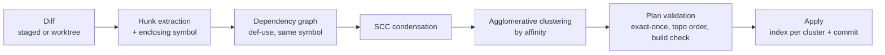

# dendrite-git-rs Architecture

`dendrite-git-rs` turns a working-tree diff into a plan of small, ordered commits that each build on their own, and manages stacked review branches. It reads repositories in-process with `gitoxide` (`gix`), so it never shells out to `git` for reads.

It ships the `dendrite-git` binary (JSON-RPC 2.0 over stdio) and the `dendrite_git` library. It makes no LLM calls: commit subjects and intent labels come from the caller. This repository supplies the hunks, constraints, validation and git operations.

## 1. Commit planning pipeline



### 1.1 Hunk extraction
Diff the index against `HEAD` (staged), or the worktree against `HEAD` (`all`), with zero context lines. Each hunk becomes:

`{id, file, old_range, new_range, added_lines, removed_lines, enclosing_symbol, defines: [symbol], uses: [symbol]}`

`enclosing_symbol`, `defines` and `uses` come from a tree-sitter pass over the post-image (the same semantics as `ast.changed_symbols` in dendrite-core-rs). Binary files and renames are single, indivisible hunks.

### 1.2 Dependency graph
Hard edges, which must be honoured:

- **def-use:** hunk B uses a symbol that hunk A defines or changes → A → B. B cannot be committed before A.
- **same symbol:** hunks inside the same enclosing symbol → a bidirectional edge, so they stay together.
- **new file:** hunks that only make sense with a new file's creation hunk → edge from the creation hunk.

Soft affinities, used for clustering only:

- same package, module or directory,
- a test and the code it covers (`foo_test.go` ↔ `foo.go`, `#[cfg(test)] mod` ↔ its parent, `test_foo.py` ↔ `foo.py`),
- cosine similarity of hunk embeddings, when the caller supplies them,
- the same caller-supplied intent label.

### 1.3 Condensation and clustering
Strongly connected components over the hard edges become indivisible units, giving a DAG of units. Units are then merged agglomeratively by weighted affinity until no pair exceeds the threshold, never merging in a way that creates a cycle in the condensed DAG.

### 1.4 Plan validation
A plan is `[{type, scope, subject, body, hunks, ticket}]`, built here or proposed by the caller. It is valid when:

1. every hunk is assigned exactly once,
2. the commit order is a topological order of the condensed graph,
3. **each prefix builds**: the cumulative patch is applied in a temporary worktree and the configured check runs (`go build ./...`, `cargo check`, …). A failing cluster is merged into its predecessor and validation repeats,
4. every subject passes the quality gate: Conventional Commits form, at least 3 meaningful words, names a symbol, scope or behaviour, and is not deny-listed (`wip`, `update files`, `third pass`, `update binary`, `chore: update files (…)`).

Hunks the caller's intent does not explain are reported as `unexplained`, so the caller can confirm them or put them in their own commit.

### 1.5 Apply
For each cluster in order: write its hunks to the index (patch application on the index, no worktree changes), then commit. A dry run returns the plan without writing.

## 2. Stacked review branches

```
review/<ticket>/01-scaffold   types, interfaces, stubs
review/<ticket>/02-logic      stacked on 01
review/<ticket>/03-tests      stacked on 02
```

- The stage comes from the plan: type and interface hunks → scaffold, bodies → logic, tests → tests. In degraded-budget mode the stacks are `local/<module-slug>` branches.
- Each tip gets a note under `refs/notes/dendrite/telemetry` holding `{tier, model, tokens, test_exit, coverage, assertion_verdict}`.
- The pending-review queue is a set of refs, not a JSON file.
- **Land** rebases or squashes a stack onto the target branch only when its verdict is `VERIFIED_COMPLETE`. It then rebases each downstream stack with `--onto <target> <old-base>`, in order.

## 3. Other operations

- **Divergence:** ahead/behind counts and the incoming commit IDs of a branch against its upstream, computed from the commit graph.
- **Worktree lifecycle:** create and remove isolated worktrees for parallel speculative variants, with guaranteed cleanup (RAII guard) on resolve or cancel.
- **Drift analysis:** for a repository sliced from an upstream, walk upstream commits since the recorded base and drop those touching only modules outside the retained-symbol manifest. The remaining commits are reported as port candidates.

## 4. Protocol

JSON-RPC 2.0, one message per line on stdin/stdout, logs on stderr. The schemas live in `proto/*.json`, versioned with semver.

| Method | Purpose |
|---|---|
| `health` | `{name: "dendrite-git", version, protocol}` |
| `git.hunk_graph` | Hunks, edges and SCC units for a diff |
| `git.cluster_hunks` | Clustered units with affinity scores |
| `git.validate_plan` | Plan checks, including per-prefix build results |
| `git.apply_plan` | Write the commits (or a dry run) |
| `git.review_stack.create` / `.telemetry` / `.land` | Stacked review branches |
| `git.divergence` | Ahead/behind and incoming commits |
| `git.worktree.create` / `.remove` | Isolated worktrees |
| `git.drift.analyze` | Upstream port candidates |

## 5. Dependencies and consumers

- **embedag** (`embedag-core`) supplies SCC detection and condensation for possibly cyclic graphs, plus topological ordering.
- **dendrite-core-rs** defines the symbol semantics (`changed_symbols`) that hunk annotation follows.
- **dendrite-control** starts `dendrite-git` from its commit and VCS commands through its sidecar client. When the binary is missing it falls back to its in-process Go implementation.
- **dendrite-mcp-hub** exposes the commit, VCS guard and audit tools that end up here.

See [RESPONSIBILITIES.md](RESPONSIBILITIES.md) for the ownership boundary and ticket map.
