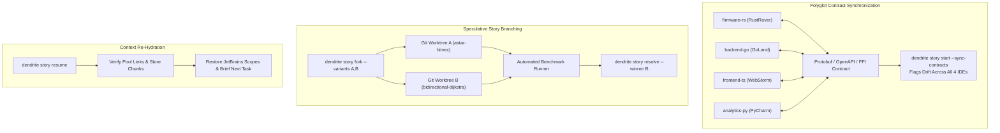

<!-- Imported from Dendrite docs/features/FEAT-032-polyglot-speculative-drift-workflows.md @ 69ea048 on 2026-10-18. Source of truth for this repo's scope; keep in sync with the Dendrite copy until the extraction umbrella lands. -->

---
id: FEAT-032
title: "Advanced Polyglot Contract Sync, Speculative Story Branching & Upstream Drift"
status: approved
plane_epic: PROJ-E-15
dependencies: [FEAT-005, FEAT-014, FEAT-023, FEAT-029, FEAT-030]
repository: dendrite
tags: [polyglot-contract, speculative-branching, git-worktree, upstream-drift, context-rehydration]
---

# FEAT-032: Advanced Polyglot Contract Sync, Speculative Story Branching & Upstream Drift

## 1. Executive Summary & Problem Statement

### The Problem
Modern polyglot applications span multiple ecosystems (e.g., Rust firmware in RustRover, Go backend in GoLand, TypeScript frontend in WebStorm, Python analytics in PyCharm). When shared interface definitions (Protobuf, OpenAPI, JSON-Schema) change, contract drift silently breaks cross-service communication. Furthermore, architectural decisions between competing algorithms are often made blindly without isolated benchmarking, and sliced downstream codebases struggle to port upstream security bug fixes cleanly.

### User Story & Architectural Pillars
As a technical lead and systems architect, I need Dendrite to:
1. Infer cross-language contract graphs across all 4 JetBrains IDEs and alert on schema drift in a single story.
2. Speculatively fork stories into isolated Git worktree branches (`dendrite story fork`), benchmark them side-by-side, and resolve to the winner.
3. Track upstream commits for sliced repositories, filter out stripped modules, and port relevant bug fixes (`dendrite ref sync --check-drift`).
4. Re-hydrate full developer context (`dendrite story resume`) after weeks away from a project.

---

## 2. Technical Architecture & Idiomatic Design Patterns

### 2.1 Git Worktree Isolation & RAII Cleanup
Speculative branching creates isolated Git worktrees under `.dendrite/worktrees/`. A RAII lifecycle controller ensures worktrees and temporary branches are safely pruned upon resolution or cancellation.

### 2.2 Sliced Upstream AST Commit Reconciliation
For projects created via repository feature slicing (Case 10):
- Dendrite maintains a provenance manifest mapping retained AST nodes to upstream commit SHAs.
- When `dendrite ref sync --check-drift` runs, changes touching un-retained modules are pruned. Bug fixes affecting retained algorithms are formatted as pull request stories.

---

## 3. Acceptance Criteria & Definition of Done

- [ ] **AC-1 (Quad-IDE Cross-Language Contract Sync)**: Monitors Protobuf, OpenAPI, and JSON-Schema definitions across GoLand, RustRover, WebStorm, and PyCharm, flagging schema drift.
- [ ] **AC-2 (Speculative Story Branching)**: Forks stories into isolated Git worktrees, executes differential benchmarks, and merges the winner with RAII cleanup.
- [ ] **AC-3 (Upstream Drift Reconciliation)**: Analyzes upstream repository commits, filters pruned modules, and ports relevant bug fixes to sliced downstream crates.
- [ ] **AC-4 (Context Re-Hydration)**: `dendrite story resume` verifies pool links and restores JetBrains IDE scopes in < 3s without cloud tokens.
- [ ] **AC-5 (Scrum DoD & Complexity)**: Cyclomatic complexity <= 15, cognitive complexity <= 20, statement coverage >= 85%.
