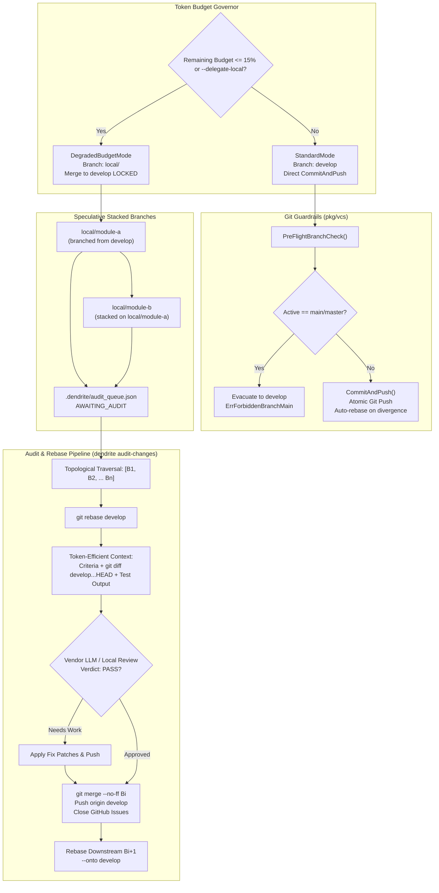

<!-- Imported from Dendrite docs/features/FEAT-070-speculative-stacked-branches-and-audit-pipeline.md @ 69ea048 on 2026-10-18. Source of truth for this repo's scope; keep in sync with the Dendrite copy until the extraction umbrella lands. -->

---
id: FEAT-070
title: "Speculative Stacked Branches, Git Guardrails, Token-Aware Degraded Mode & Vendor LLM Audit Pipeline"
status: approved
plane_epic: PROJ-E-30
dependencies: [FEAT-002, FEAT-008, FEAT-013, FEAT-028, FEAT-098]
repository: dendrite
tags: [git, guardrails, stacked-branches, token-economy, audit-changes, degraded-mode, plane, github]
---

# FEAT-070: Speculative Stacked Branches, Git Guardrails, Token-Aware Degraded Mode & Vendor LLM Audit Pipeline

## 1. Executive Summary & Problem Statement

### 1.1 The Problem
When operating autonomous agents in commercial cloud environments (AGY, Gemini Pro, Claude 3.5 Sonnet), token budgets are strictly bounded by daily and weekly sliding-window quotas. During extended coding runs or quota exhaustion (e.g. remaining quota $\le 15\%$), development usually halts completely, resulting in idle engineering pipelines.

Furthermore, autonomous agents operating directly in repositories risk:
1. Accidentally polluting or mutating the production `main` or `master` branch.
2. Generating unpushed local commits that can be lost across ephemeral container lifecycles or diverging from remote tracking branches.
3. Committing speculative code directly to `develop` without formal review gates.

### 1.2 The Solution
FEAT-070 implements a 5-phase closed-loop architecture for zero-cost continuous development:
1. **Git Branch Guard (`pkg/vcs`)**:
   - Strictly prohibits direct commits to `main`/`master` via `PreFlightBranchCheck()` returning `ErrForbiddenBranchMain`.
   - Automatically evacuates to `develop`.
   - Enforces atomic `CommitAndPush()` transactions, pushing each commit immediately to remote origin with automatic rebase on divergence.
2. **Ticket Domain Model, Triage & Low-Budget Prioritization (`pkg/tracker`)**:
   - Classifies tickets with `DifficultyTier` (L1_TRIVIAL through L5_CRITICAL), `InferenceEngine` (`LOCAL_LLM`, `VENDOR_FAST`, `VENDOR_REASONING`), and `AuditStatus` (`NONE`, `PENDING_VENDOR_AUDIT`, `AUDITED_AND_MERGED`, `ESCALATED_TO_VENDOR`).
   - Routes L1/L2 and low-budget L3 tickets to zero-cost local models (`qwen3.8:27b` on Apple Silicon Metal), deferring L4/L5 until vendor budget restoration.
   - Sorts execution queues prioritizing P0 blockers and `LocalFeasible` items.
3. **GitHub Issues Two-Way Synchronizer (`pkg/tracker/github`)**:
   - Synchronizes Plane and local ticket state with remote GitHub repository issues (`yasuomaidana/dendrite`).
   - Auto-provisions semantic labels: `P0-TOP-BLOCKER`, `local-llm-delegated`, `needs-vendor-audit`, and `module:<name>`.
   - Records remote issue IDs and encodes `Depends on #<id>` DAG relations into issue markdown bodies.
4. **Speculative Stacked Branch Orchestrator (`pkg/vcs`)**:
   - Automatically enters `DegradedBudgetMode` when token budget $\le 15\%$ or when `--delegate-local` is set.
   - Forbids merging into `develop` at code level (`ErrMergeLockedInDegradedMode`).
   - Spawns speculative stacked branches `local/<module-slug>` off `develop` (or parent local branches).
   - Validates each step via local gates (`go test ./...`), commits atomically, pushes to `origin/local/<module>`, and registers state in `.dendrite/audit_queue.json`.
5. **Vendor LLM `audit-changes` Command & Rebase Pipeline (`pkg/audit`, `cmd/dendrite`)**:
   - Traverses queued branches topologically from root to leaf.
   - Assembles minimal token payloads (ticket criteria, `git diff develop...HEAD`, test and linter output).
   - Validates changes and applies surgical fixes.
   - Non-fast-forward merges validated branches into `develop`, pushes immediately, and cascades rebases onto downstream stacked branches.

---

## 2. Technical Architecture & State Machine

---

## 3. Sequence Matrix & Domain Model

### 3.1 Sequenced Tickets (TOP 1 Blockers)

| Sequence | Plane ID | Title | Difficulty Tier | Assigned Engine | Blocked By |
|:---|:---|:---|:---|:---|:---|
| **SEQ-001** | `DEN-701` | Git Branch Guard: main lock, develop default & atomic CommitAndPush | `TierL2Low` (2) | `LOCAL_LLM` | *None (Root)* |
| **SEQ-002** | `DEN-702` | Ticket Domain Model, Triage & Low-Budget DAG Prioritizer | `TierL2Low` (2) | `LOCAL_LLM` | `DEN-701` |
| **SEQ-003** | `DEN-703` | GitHub Issues Two-Way Synchronizer & Label Provisioner | `TierL3Medium` (3) | `LOCAL_LLM` | `DEN-702` |
| **SEQ-004** | `DEN-704` | Speculative Stacked Branch Orchestrator & Degraded Budget Mode | `TierL3Medium` (3) | `LOCAL_LLM` | `DEN-703` |
| **SEQ-005** | `DEN-705` | `dendrite audit-changes` CLI Command & Vendor LLM Rebase Engine | `TierL4High` (4) | `VENDOR_FAST` / `LOCAL_LLM` fallback | `DEN-704` |

---

## 4. CLI & Native MCP Interfaces

### 4.1 CLI Commands
- `dendrite audit-changes [--branch <name>] [--dry-run] [--max-tokens <int>]`
- `dendrite vcs guard [--mode standard|degraded]`
- `dendrite tracker sync github [--repo <owner/repo>] [--dry-run]`

### 4.2 Native MCP Tools
- `dendrite_audit_changes`: MCP tool to invoke topological branch audit, fix validation, and merge into develop.
- `dendrite_github_sync`: MCP tool to synchronize tickets with GitHub Issues with automatic label provisioning.
